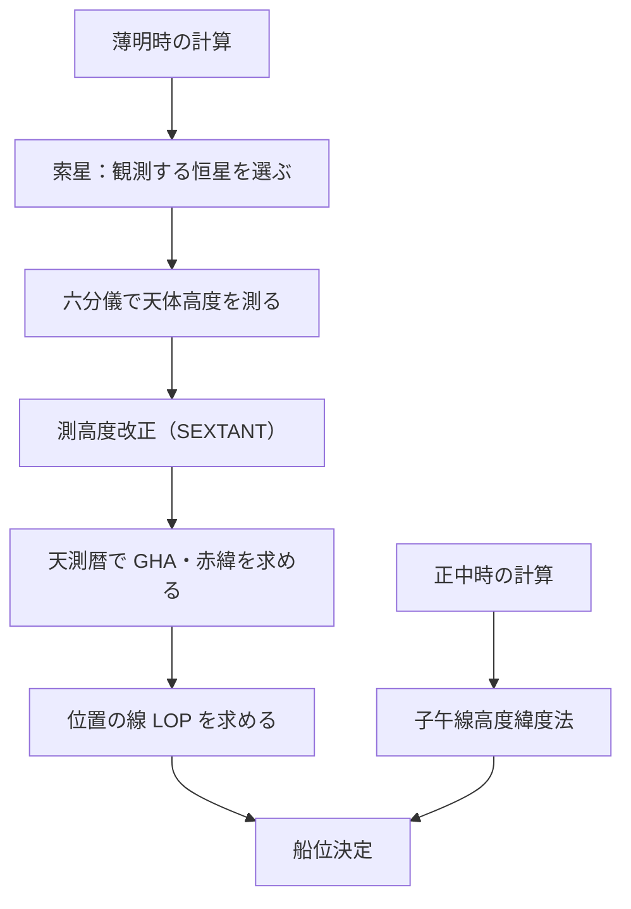
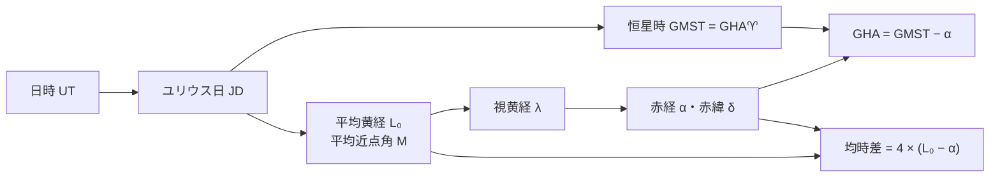
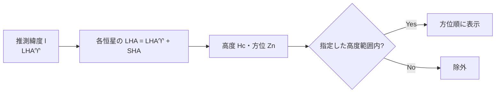
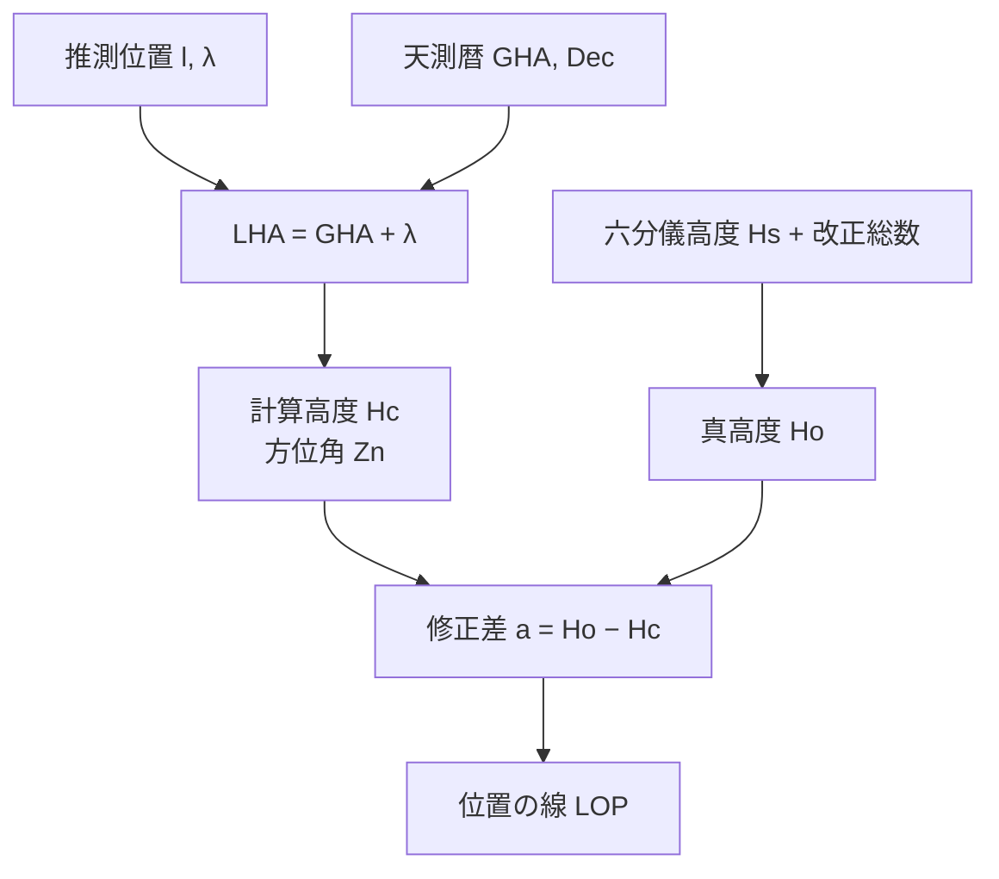
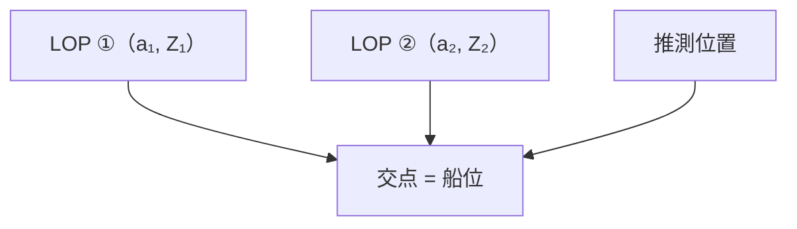
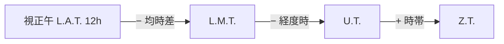

# 天文航法 ASTRO. NAV

天体観測に基づく船位決定のための計算です。航法計算機 TAMAYA NC-2200 の「天文航法 ASTRO. NAV」を参考にした構成です。

| 計算機         | NC-2200 での機能名          | 実装                            |
| -------------- | --------------------------- | ------------------------------- |
| 薄明時の計算   | Twilight                    | `astronomy.ts`                  |
| 索星の計算     | Prediction & Identification | `astronomy.ts`, `data/stars.ts` |
| 天測暦の計算   | Nautical Almanac            | `ephemeris.ts`                  |
| 位置の線の計算 | Line of Position            | `astronomy.ts`                  |
| 船位決定の計算 | Position Fix                | `astronomy.ts`                  |
| 正中時の計算   | Meridian Passage            | `astronomy.ts`                  |

> 出没方位角・ジャイロ誤差は NC-2200 の天文航法には含まれないため、海技試験カテゴリ（[exam.md](exam.md)）で扱います。

## 全体の流れ

---

## 天測暦の計算 (Nautical Almanac)

日時（UT）から、太陽のグリニッジ時角 GHA・赤緯・均時差、春分点のグリニッジ時角 GHA♈ を求めます。

### 計算方法

Meeus の略算式による簡易暦です。

均時差は「視太陽時 − 平均太陽時」（分）です。L₀ − α は ±180° に正規化してから 4 倍するので、年末年始に値が跳ぶことはありません。精度はおおむね 1′ 以内です。

### 用語

| 用語 | 意味                                               |
| ---- | -------------------------------------------------- |
| GHA  | グリニッジ時角（グリニッジ子午線から西回りに測る） |
| LHA  | 地方時角 = GHA + 経度（東経正）                    |
| SHA  | 恒星時角（春分点から西回りに測った恒星の位置）     |
| Dec  | 赤緯                                               |

---

## 薄明時の計算 (Twilight)

日付と位置から、日出没と各薄明の時刻を地方平時 (LMT) と標準時 (ZT) で求めます。赤緯と均時差は天測暦の計算から自動で求めます。

### 薄明の種類

| 種類     | 太陽の中心高度 | 目安                                   |
| -------- | -------------- | -------------------------------------- |
| 日出没   | −50′           | 大気差 34′ + 視半径 16′                |
| 市民薄明 | −6°            | 水平線がはっきり見える                 |
| 航海薄明 | −12°           | 星と水平線が両方見える（天測に適する） |
| 天文薄明 | −18°           | 空が完全に暗くなる                     |

### 計算式

$$
\cos t = \frac{\sin h - \sin l \sin \delta}{\cos l \cos \delta}
$$

$$
\text{LMT} = 12^h - \text{均時差} \mp \frac{t}{15}
$$

$$
\text{ZT} = \text{LMT} - \frac{\lambda - \lambda_z}{15}
$$

λ_z は標準子午線です。まず正午の赤緯で概算し、その時刻の赤緯・均時差で 1 回反復します。|cos t| > 1 の場合はその現象が起こらない（白夜・極夜）ので「—」と表示します。

---

## 索星の計算 (Prediction & Identification)

推測緯度と春分点の地方時角 LHA♈ から、恒星の高度・方位を求めます（59 個の航海用恒星）。

### 予測 (Prediction)

$$
\sin H_c = \sin l \sin \delta + \cos l \cos \delta \cos \text{LHA}
$$

$$
\cos Z = \frac{\sin \delta - \sin l \sin H_c}{\cos l \cos H_c}
$$

LHA が 0〜180°（天体が子午線の西）のときは Zn = 360° − Z です。

### 同定 (Identification)

観測した天体の高度 h と方位 Zn から、どの恒星かを特定します。

$$
\sin \delta = \sin l \sin h + \cos l \cos h \cos Z_n
$$

$$
\cos t = \frac{\sin h - \sin l \sin \delta}{\cos l \cos \delta}
$$

方位が東側なら LHA = 360° − t、西側なら LHA = t とし、SHA = LHA − LHA♈ を求めて、SHA・赤緯が最も近い恒星を表示します。差が 3° を超える場合は、惑星の可能性や入力の誤りを注意として表示します。

---

## 位置の線の計算 (Line of Position)

推測位置と観測した真高度から、計算高度・方位角・修正差を求めます。

### 計算フロー

### 計算式

Hc・Zn は索星と同じ式です。

$$
a = H_o - H_c
$$

- a > 0: Toward（天体に向かって a 海里移動した点を通る）
- a < 0: Away（天体から離れる向き）

---

## 船位決定の計算 (Position Fix)

2 本の位置の線（修正差 a・方位角 Zn）の交点から船位を求めます。

推測位置を原点とし、北方向の変位を D.Lat、東方向の変位を Dep とすると、各 LOP は

$$
\text{D.Lat} \cos Z_i + \text{Dep} \sin Z_i = a_i \quad (i = 1, 2)
$$

この連立方程式を解いて船位を求めます（推測位置付近の平面近似）。

$$
l = l_{DR} + \text{D.Lat}, \qquad \lambda = \lambda_{DR} + \frac{\text{Dep}}{\cos l_m}
$$

2 本の LOP がほぼ平行（方位角の差が 0° または 180° に近い）な場合は交点が定まらないため計算できません。

---

## 正中時の計算 (Meridian Passage)

太陽が観測者の子午線を通過する時刻（正中時）を求めます。正中時の真高度を入力すると、子午線高度緯度法で緯度も求めます。

### 正中時刻

$$
\text{LMT} = 12^h - \text{均時差}, \qquad \text{UT} = \text{LMT} - \frac{\lambda}{15}, \qquad \text{ZT} = \text{UT} + \frac{\lambda_z}{15}
$$

均時差は正中時の UT で天測暦を引き直して 2 回反復します。

### 子午線高度緯度法

$$
z = 90^\circ - H_o
$$

| 正中時の太陽の方向 | 緯度      |
| ------------------ | --------- |
| 南（南中）         | l = δ + z |
| 北（北中）         | l = δ − z |

（δ・l は北を正とする）
