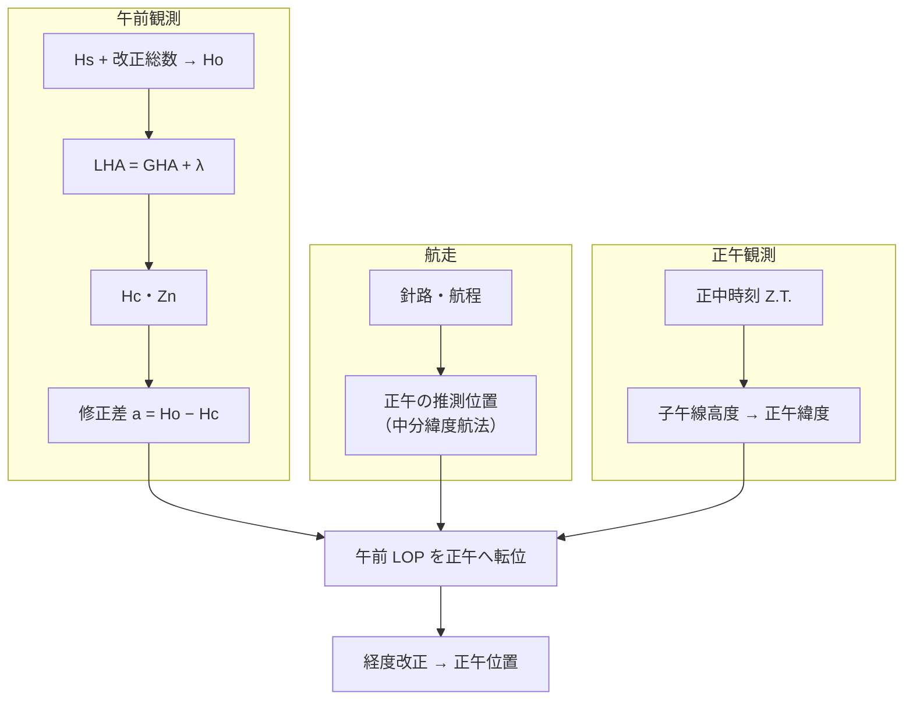

# 海技試験 EXAM

三級海技士（3N）の筆記試験で出題される計算問題を、途中式つきの解答形式で表示します。PILOT・ASTRO・SEXTANT と同じ計算は同じ関数を使い（試験用に再実装しない）、試験固有の計算だけを `examNavigation.ts` / `examOperation.ts` に置いています。

---

# 3N 航海

| 計算機                   | 使う計算                             |
| ------------------------ | ------------------------------------ |
| 天体による船位の決定     | `astronomy.ts`, `mercatorSailing.ts` |
| 平行航法・正子午線航法   | `examNavigation.ts`                  |
| 大圏航法                 | `greatCircle.ts`（PILOT 1 と共通）   |
| 真風の計算               | `wind.ts`（PILOT 2 と共通）          |
| 潮流中の針路             | `currentVector.ts`（PILOT 2 と共通） |
| 推測位置の計算           | `mercatorSailing.ts`（中分緯度航法） |
| 光達距離                 | `sextant.ts`（SEXTANT と共通）       |
| 潮汐表の使用法（潮流）   | `tide.ts`（PILOT 2 と共通）          |
| クロス方位法             | `examNavigation.ts`                  |
| 両測方位法               | `examNavigation.ts`                  |
| 船内時計の改正           | `examNavigation.ts`                  |
| 常用日出没時             | `astronomy.ts`（薄明時の計算と共通） |
| 出没方位角・ジャイロ誤差 | `astronomy.ts`                       |

## 天体による船位の決定（メリパス）

午前の太陽観測による位置の線と、正午の子午線高度緯度法を組み合わせて、正午の船位を求めます。

### 全体の流れ

### 計算手順

1. **午前の位置の線:** Ho = Hs + 改正総数、LHA = GHA + λ、Hc・Zn を求め、修正差 a = Ho − Hc。
2. **正午の推測位置:** 午前の推測位置から針路・航程で中分緯度航法により求める。
3. **正中時刻:** L.M.T. = 12h − 均時差、U.T. = L.M.T. − 経度時、Z.T. = U.T. + 時帯。
4. **正午緯度:** z = 90° − Ho。太陽が南中なら l = δ + z、北中なら l = δ − z。
5. **経度の改正:** 正午緯度と推測緯度の差 ΔL（マイル）と午前の LOP から

$$
\text{東西距改正} = \frac{a}{\sin Z} - \frac{\Delta L}{\tan Z}, \qquad \text{経度改正} = \frac{\text{東西距改正}}{\cos l}
$$

## 平行航法・正子午線航法

| 航法         | 航程                   | 針路        |
| ------------ | ---------------------- | ----------- |
| 平行航法     | Dist. = D.Long × cos l | 090° / 270° |
| 正子午線航法 | Dist. = D.Lat          | 000° / 180° |

## 潮流中の針路

対水速力を一定として、潮流がある海域で目的の針路線上を進むための視針路を求めます。式は PILOT 2 の「視針路・実航速力」と同じです（[pilot2.md](pilot2.md)）。

$$
\sin\beta = -\frac{D_r}{V}\sin(\text{Set} - \text{針路線}), \qquad \text{視針路} = \text{針路線} + \beta
$$

## クロス方位法

位置が分かっている 2 物標 A・B の真方位から船位を求めます。物標付近の狭い範囲なので平面（中分緯度）近似で解きます。

$$
\vec{A} = \vec{S} + r_1 \vec{u}_1, \qquad \vec{B} = \vec{S} + r_2 \vec{u}_2
$$

（S: 船位、u: 方位の単位ベクトル、r: 物標までの距離）。r₁, r₂ が正にならない（方位線が船の前方で交わらない）組み合わせはエラーにします。交角が 30° 未満・150° 超のときは精度が低いことを注記します。

## 両測方位法（ランニングフィックス）

1 物標を 2 回測った真方位と、その間の航走（針路・速力・経過時間）から第 2 測定時の船位を求めます。

$$
r_1 \vec{u}_1 - r_2 \vec{u}_2 = \vec{R} \quad （\vec{R}: \text{航走ベクトル}）
$$

$$
\text{船位} = \text{物標} - r_2 \vec{u}_2
$$

## 船内時計の改正

経度差 1° につき 4 分。東航すれば時計を進め、西航すれば遅らせます。変経は ±180° に正規化します。

## 常用日出没時

日付と位置から日出没を地方平時で求め、経度時差で標準時に直します（ASTRO の薄明時の計算と同じ方法、太陽の中心高度 −50′）。

$$
\text{ZT} = \text{LMT} - \frac{\lambda - \lambda_z}{15}
$$

## 出没方位角・ジャイロ誤差

$$
\cos Z = \frac{\sin \delta}{\cos l}
$$

Z は北から測った真方位で、日出なら Zn = Z、日没なら Zn = 360° − Z。出没方位角は E/W から測った角度（例: W 22.1° S）でも表示します。

$$
\text{ジャイロ誤差} = \text{真方位} - \text{ジャイロ方位}
$$

正なら偏東 (E)、負なら偏西 (W) です。

---

# 3N 運用

実装は `examOperation.ts` です。位置・LCF は船体中央から前方を正とします。

| 計算機               | 主な式                                                        |
| -------------------- | ------------------------------------------------------------- |
| TPC・平均喫水        | TPC = L × B × 0.01 × ρ、沈下量 = w / TPC                      |
| トリム・前後喫水変化 | 下記                                                          |
| 横揺れ周期と GM      | T = 0.8 B / √GM、GM_B = GM_A × (T_A / T_B)²                   |
| 比重差と入港喫水     | 下記                                                          |
| 見張り死角距離       | x = 水平距離 × 障害物高 / (眼高 − 障害物高)（水面からの高さ） |
| 等喫水化バラスト移送 | 移送量 = トリム × MTC / 移送距離                              |
| 前後喫水から積載重量 | 積載量 = TPC × 平均喫水の変化                                 |
| 比重差による平均喫水 | 喫水変化 = W / TPC × (ρ₁ − ρ₂) / ρ₂                           |

### トリム・前後喫水変化

$$
\text{平均沈下} = \frac{w}{\text{TPC}}, \qquad \text{トリム変化} = \frac{w \times d}{\text{MTC}}
$$

（d: LCF からの積載位置）。トリム変化を LCF から船首・船尾までの距離の比で配分します。

$$
\text{船首喫水変化} = \text{平均沈下} - \text{トリム} \times \frac{L/2 - \text{LCF}}{L}, \qquad
\text{船尾喫水変化} = \text{平均沈下} + \text{トリム} \times \frac{L/2 + \text{LCF}}{L}
$$

### 比重差と入港喫水

1. 燃料・清水の消費による浮上 = 消費量 / TPC
2. 比重差による沈下 = W / TPC × (ρ₁ − ρ₂) / ρ₂（W: 消費後の排水量）
3. 消費によるトリム変化 = Σ 消費量 × (タンク位置 − LCF) / MTC（前方の重量を除くと船尾トリムが増える）
4. 上の平均喫水とトリム変化から入港時の船首・船尾喫水を求める
