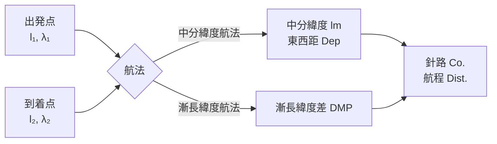
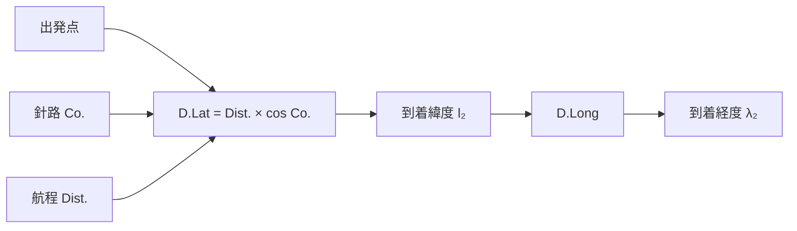
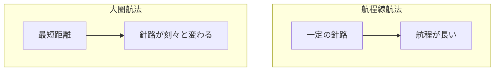
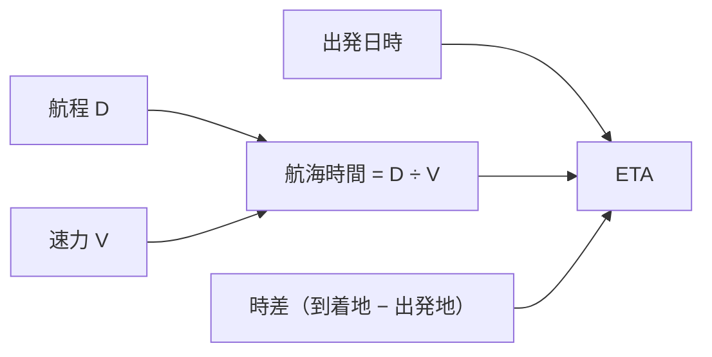

# 航海計画 PILOT 1

航路計画に必要な基本的な航法計算です。カテゴリ構成は TAMAYA 航法計算機 航法計算機 TAMAYA NC-2200 の「航海計画 PILOT 1」を参考にした構成です。

| 計算機             | NC-2200 での機能名        | 実装                 |
| ------------------ | ------------------------- | -------------------- |
| 針路・航程の計算   | Course and Distance       | `mercatorSailing.ts` |
| 到着点の計算       | Dead Reckoning            | `mercatorSailing.ts` |
| 大圏航法の計算     | Great Circle              | `greatCircle.ts`     |
| 集成大圏航法の計算 | Composite Sailing         | `greatCircle.ts`     |
| 到着時刻の計算     | Estimated Time of Arrival | `ETACalc.svelte`     |

緯度は北緯、経度は東経を正として計算します。変経は ±180° に正規化するので、日付変更線をまたぐ航路もそのまま計算できます。

---

## 針路・航程の計算 (Course and Distance)

2 地点間の針路と航程を、中分緯度航法または漸長緯度航法で求めます。

### 計算フロー

### 中分緯度航法

$$
\text{D.Lat} = l_2 - l_1, \qquad \text{D.Long} = \lambda_2 - \lambda_1
$$

$$
l_m = \frac{l_1 + l_2}{2}, \qquad \text{Dep} = \text{D.Long} \times \cos l_m
$$

$$
\text{Co.} = \arctan\frac{\text{Dep}}{\text{D.Lat}}, \qquad \text{Dist.} = \frac{\text{D.Lat}}{\cos \text{Co.}}
$$

「手計算相当」モードでは、変緯・変経・中分緯度・東西距・針路を各段階で小数第 1 位に丸めて計算し、関数電卓による手計算の答えに合わせます。

### 漸長緯度航法

$$
\text{Co.} = \arctan\frac{\text{D.Long}}{\text{DMP}}, \qquad \text{Dist.} = \frac{\text{D.Lat}}{\cos \text{Co.}}
$$

漸長緯度 MP は WGS84 楕円体（離心率 e = 0.0818191908426）の式で計算します。

$$
\text{MP}(l) = \frac{10800}{\pi}\left[\ln \tan\left(\frac{\pi}{4} + \frac{l}{2}\right) - \frac{e}{2}\ln\frac{1 + e\sin l}{1 - e\sin l}\right]
$$

> **補足:** 変緯が 0（真東・真西）のときは平行航法として Dist. = |D.Long| × cos l で求めます。結果シートには 360 度式の針路に加えて 90 度式（例: S 65.6° W）も表示します。

---

## 到着点の計算 (Dead Reckoning)

出発点・針路・航程から到着点を求めます。

### 計算フロー

### 計算式

$$
\text{D.Lat} = \text{Dist.} \times \cos \text{Co.}, \qquad \text{Dep} = \text{Dist.} \times \sin \text{Co.}
$$

| 航法         | 変経                                            |
| ------------ | ----------------------------------------------- |
| 中分緯度航法 | D.Long = Dep / cos l_m                          |
| 漸長緯度航法 | D.Long = DMP × tan Co.（DMP = MP(l₂) − MP(l₁)） |

---

## 大圏航法の計算 (Great Circle)

2 地点間の大圏距離、初針路・終針路、頂点の位置を求めます。

### 航路比較

### 計算式

**大圏距離 D:**

$$
\cos D = \sin l_1 \sin l_2 + \cos l_1 \cos l_2 \cos \text{D.Long}
$$

**初針路 C:**

$$
\tan C = \frac{\sin \text{D.Long}}{\cos l_1 \tan l_2 - \sin l_1 \cos \text{D.Long}}
$$

象限は分子・分母の符号で決めます（`atan2`）。**終針路**は、到着点から出発点への初針路に 180° を加えたものです。

**頂点 (Vertex):** 大圏上で最も緯度が高くなる点です。

$$
\cos l_v = \cos l_1 \sin C
$$

実装では、大圏面の法線ベクトルに地軸を射影して頂点の緯度・経度を求めています（上の式と同値で、象限の場合分けが不要）。南半球の航路では南側の頂点を採用し、頂点が出発点と到着点の間にない場合は結果シートに注記します。

---

## 集成大圏航法の計算 (Composite Sailing)

制限緯度 l_v を超えないよう「大圏 → 平行圏 → 大圏」と航行する航路です。高緯度の荒天域や氷海を避けるときに使います。

### 航路構成

### 計算式

出発地から制限緯度に接する大圏（V₁ が頂点）について、ナピアの法則より

$$
\sin C_1 = \frac{\cos l_v}{\cos l_1}, \qquad \cos \text{DLo}_1 = \frac{\tan l_1}{\tan l_v}, \qquad \cos D_1 = \frac{\sin l_1}{\sin l_v}
$$

到着地側（大圏②）も同じ式で D₂・DLo₂ を求め、平行圏区間は

$$
\text{DLo}_p = |\text{D.Long}| - \text{DLo}_1 - \text{DLo}_2, \qquad D_p = \text{DLo}_p \times \cos l_v
$$

$$
\text{総航程} = D_1 + D_p + D_2
$$

> **補足:** 通常の大圏の頂点が制限緯度を超えない場合は、集成大圏にする必要がないため通常の大圏航法の結果を表示します。

---

## 到着時刻の計算 (Estimated Time of Arrival)

航程・速力・出発日時から、航海時間と到着予定日時を求めます。

### 計算フロー

$$
\text{ETA} = \text{出発日時} + \frac{\text{航程}}{\text{速力}} + \text{時差}
$$

時差は船内時計を進めるなら +、遅らせるなら − で入力します。日付をまたぐ場合は到着予定日も表示します。
