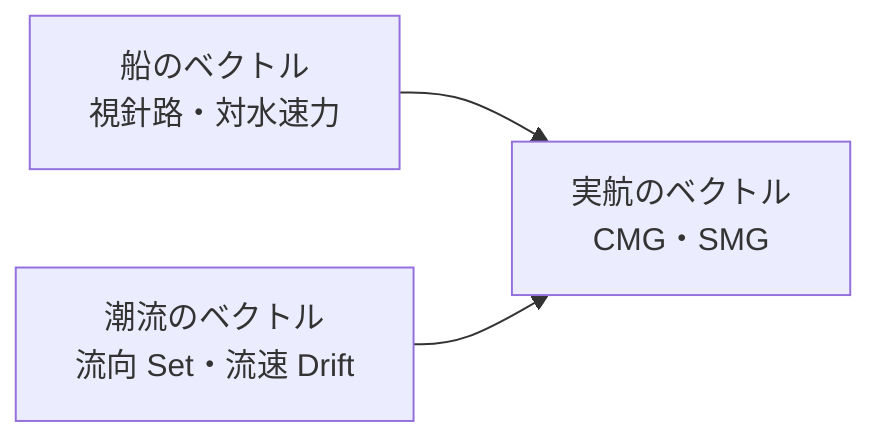
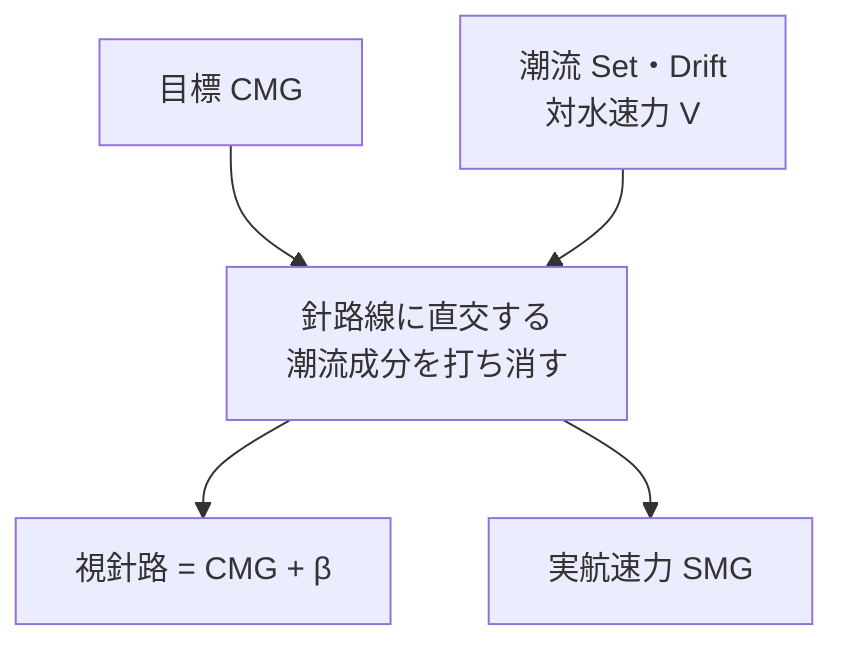
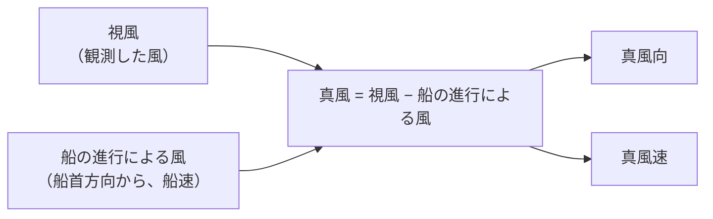
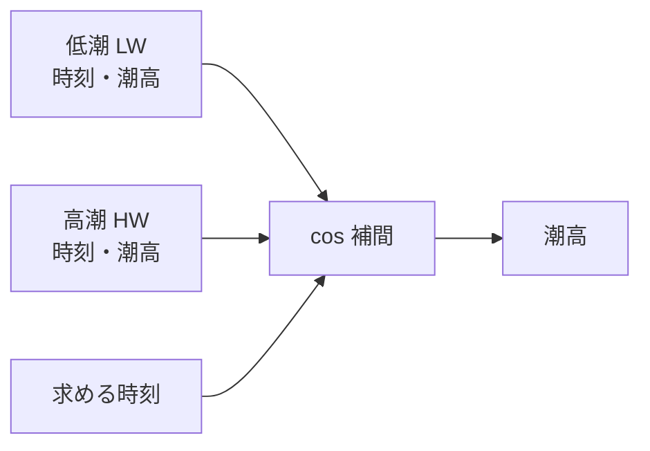
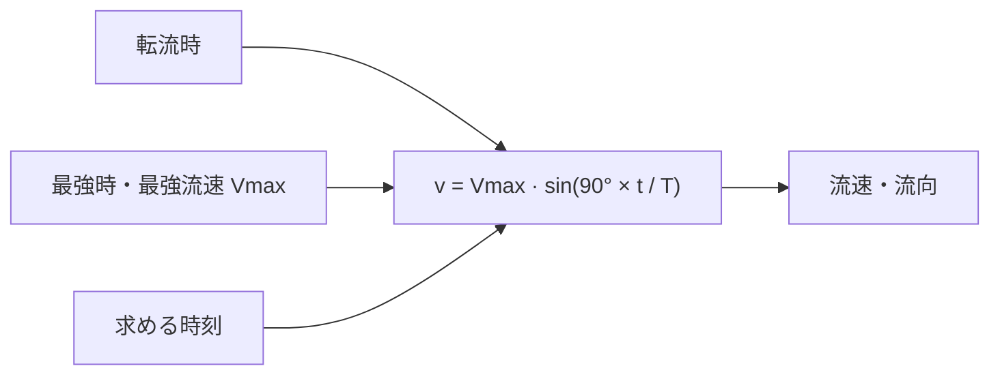

# その他の航法 PILOT 2

潮流・風・潮汐など外的要因を考慮した航法計算です。NC-2200 の「その他の航法 PILOT 2」に対応しています。

| 計算機             | NC-2200 の機能名                    | 実装               |
| ------------------ | ----------------------------------- | ------------------ |
| 実航針路・実航速力 | Course and Speed Made Good          | `currentVector.ts` |
| 視針路・対水速力   | Course and Speed to Make Good       | `currentVector.ts` |
| 視針路・実航速力   | Course to Steer and Speed Made Good | `currentVector.ts` |
| 潮の流向・流速     | Set and Drift                       | `currentVector.ts` |
| 真風向・風速の計算 | Direction and Speed of True Wind    | `wind.ts`          |
| 潮高計算           | Tide at Standard Port               | `tide.ts`          |
| 潮流計算           | Tidal Stream                        | `tide.ts`          |

潮流航法の 4 つの計算はいずれも同じ「潮流三角形」を、どの辺が未知かで解き分けたものです。

$$
\vec{G} = \vec{S} + \vec{C}
$$

各ベクトルは北成分 N = V cos θ、東成分 E = V sin θ に分解して計算します。

---

## 実航針路・実航速力 (Course and Speed Made Good)

船の視針路・対水速力と潮流から、実際に進む針路 (CMG) と速力 (SMG) を求めます。

$$
N = V\cos \text{Co.} + D_r\cos \text{Set}, \qquad E = V\sin \text{Co.} + D_r\sin \text{Set}
$$

$$
\text{CMG} = \arctan\frac{E}{N}, \qquad \text{SMG} = \sqrt{N^2 + E^2}
$$

---

## 視針路・対水速力 (Course and Speed to Make Good)

目標の実航針路 (CMG) と実航速力 (SMG) を実現するために必要な視針路と対水速力を求めます。

$$
\vec{S} = \vec{G} - \vec{C}
$$

---

## 視針路・実航速力 (Course to Steer and Speed Made Good)

対水速力 V を一定として、目標の針路線 (CMG) 上を進むための視針路と、そのときの実航速力を求めます。

針路線と潮流のなす角を α = Set − CMG とすると、

$$
\sin\beta = -\frac{D_r}{V}\sin\alpha, \qquad \text{視針路} = \text{CMG} + \beta
$$

$$
\text{SMG} = V\cos\beta + D_r\cos\alpha
$$

> **注意:** |sin β| > 1 または SMG ≦ 0 のときは、潮流が強すぎて針路線上を進めないため計算できません。

---

## 潮の流向・流速 (Set and Drift)

船の視針路・対水速力と、実際に進んだ実航針路・実航速力から潮流を求めます。

$$
\vec{C} = \vec{G} - \vec{S}
$$

$$
\text{Set} = \arctan\frac{E_G - E_S}{N_G - N_S}, \qquad \text{Drift} = \sqrt{(N_G - N_S)^2 + (E_G - E_S)^2}
$$

---

## 真風向・風速の計算 (Direction and Speed of True Wind)

船上で観測した視風（見かけの風）と船の針路・速力から真風を求めます。視風向は「船首から右回りの角度（相対）」と「真方位」のどちらでも入力できます。

### ベクトル分解

風向は「風が吹いてくる方向」なので、吹いてくる方向を正とした成分で考えます。船が進むと、船首方向から船速と同じ速さの風を受けるため、

$$
\vec{W}_{\text{true}} = \vec{W}_{\text{app}} - \vec{V}_{\text{ship}}
$$

| 記号   | 意味                                     |
| ------ | ---------------------------------------- |
| W_app  | 視風（真方位 = 針路 + 相対風向、視風速） |
| V_ship | 船の針路方向・船速のベクトル             |
| W_true | 真風（吹いてくる方位・風速）             |

---

## 潮高計算 (Tide at Standard Port)

高潮・低潮の時刻と潮高から、任意の時刻の潮高を cos 補間法で求めます。時刻は時・分で入力します。

### 潮汐曲線

### 計算式

$$
h = L + \frac{R}{2}\left(1 - \cos\frac{\pi t}{T}\right)
$$

| 記号 | 意味                                                 |
| ---- | ---------------------------------------------------- |
| L    | 低潮の潮高                                           |
| R    | 潮差 = 高潮の潮高 − 低潮の潮高                       |
| T    | 低潮と高潮の時間間隔                                 |
| t    | 低潮からの経過時間（下げ潮では時間をさかのぼる向き） |

t/T を「低潮から高潮へ向かう割合」として扱うので、上げ潮・下げ潮のどちらも同じ式で計算できます。日付をまたぐ時刻（例: 低潮 23:00、高潮 05:00）にも対応します。求める時刻は低潮と高潮の間でなければなりません。

---

## 潮流計算 (Tidal Stream)

潮流表の転流時・最強時・最強流速から、任意の時刻の流速を正弦法で求めます。

$$
v = V_{\max} \sin\left(90^\circ \times \frac{t}{T}\right)
$$

| 記号 | 意味                           |
| ---- | ------------------------------ |
| T    | 転流時から最強時までの間隔     |
| t    | 転流時から求める時刻までの時間 |

転流時から次の転流時（最強時の 2 倍の時間）までが有効範囲です。海技試験の「潮汐表の使用法（潮流）」も同じ計算を使っています。
