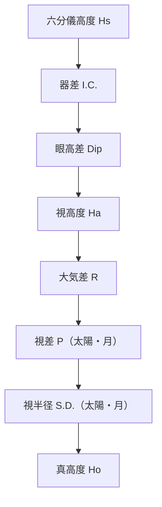
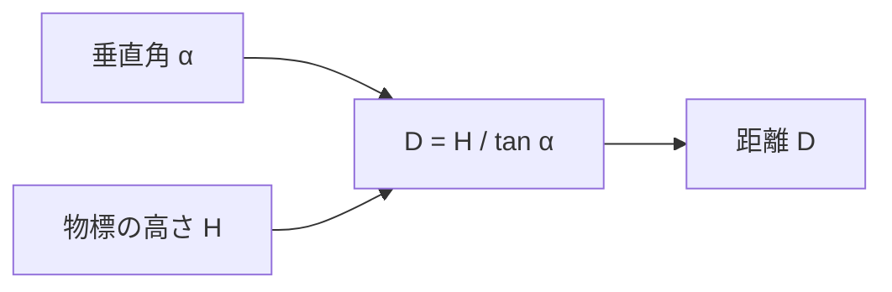

# 六分儀 SEXTANT

六分儀による測定値の改正と、六分儀を使った距離の計算です。NC-2200 の「六分儀 SEXTANT」に対応しています。

| 計算機           | NC-2200 の機能名     | 実装         |
| ---------------- | -------------------- | ------------ |
| 測高度改正の計算 | Altitude Corrections | `sextant.ts` |
| 物標までの距離   | Distance to Object   | `sextant.ts` |

---

## 測高度改正の計算 (Altitude Corrections)

六分儀で測った天体の高度（六分儀高度 Hs）を真高度 Ho に改正します。天体は太陽下辺・太陽上辺・月下辺・恒星・惑星から選びます。

### 改正の流れ

### 計算式

$$
H_a = H_s + \text{I.C.} - \text{Dip}
$$

$$
H_o = H_a - R + P \pm \text{S.D.}
$$

**眼高差**（h_e: 眼高 [m]）:

$$
\text{Dip} = 1.76' \sqrt{h_e}
$$

**大気差**（Bennett の式、気温 T [℃]・気圧 P [hPa] で補正）:

$$
R = \cot\left(H_a + \frac{7.31}{H_a + 4.4}\right) \times \frac{P}{1010} \times \frac{283}{273 + T} \quad [']
$$

**視差:**

| 天体       | 視差 P                 |
| ---------- | ---------------------- |
| 太陽       | 0.15′ × cos Ha         |
| 月         | HP（水平視差）× cos Ha |
| 恒星・惑星 | 0                      |

**視半径:** 下辺を測った場合は + S.D.、上辺を測った場合は − S.D.（太陽・月のみ）。

器差は改正値（オン・ザ・アークなら負）で入力します。結果シートには各改正値と改正総数を表示します。

---

## 物標までの距離 (Distance to Object)

### 垂直角による距離

六分儀で物標の頂部と水際（基部）との垂直角 α を測り、物標までの距離を求めます。

$$
D = \frac{H}{\tan \alpha}
$$

頂部の仰角と水際の俯角の和が α になるため、眼高を差し引く必要はありません。物標の基部が水平線より手前に見えている（近距離の）場合に使える方法です。

### 光達距離

灯台の灯火が見え始める地理学的光達距離です。

$$
D = 2.083\left(\sqrt{H} + \sqrt{h}\right) \quad [\text{海里}]
$$

| 記号 | 意味     |
| ---- | -------- |
| H    | 灯高 [m] |
| h    | 眼高 [m] |

海技試験の「光達距離」も同じ関数を使っています。
