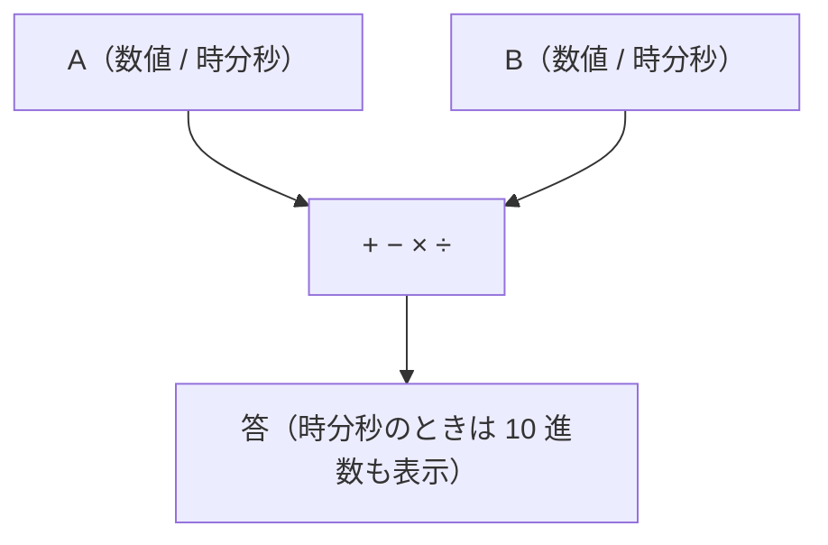

# 時間と弧度 TIME & ARC / 四則計算と時変換 TIME Calculations

航海計算で頻繁に使う、時間と弧度の換算、時分秒の計算です。航法計算機 TAMAYA NC-2200 の「時間と弧度 TIME & ARC」「四則計算と時変換 TIME Calculations」を参考にした構成です。実装は `timeConversion.ts` です。

| カテゴリ         | 計算機                           | NC-2200 での機能名  |
| ---------------- | -------------------------------- | ------------------- |
| 時間と弧度       | 時間計算と弧度換算               | Time Computation    |
| 時間と弧度       | 角度計算と時間換算               | Arc Computation     |
| 四則計算と時変換 | 時分秒変換・航走時間計算         | To HMS              |
| 四則計算と時変換 | 10進数時変換・速力、航走距離計算 | To HHH              |
| 四則計算と時変換 | 四則計算                         | Normal Computations |

---

## 時間と弧度の関係

地球は 24 時間で 360° 回転するため、次の関係があります。

| 時間 | 弧度 |
| ---- | ---- |
| 1h   | 15°  |
| 1m   | 15′  |
| 1s   | 15″  |
| 4m   | 1°   |
| 4s   | 1′   |

---

## 時間計算と弧度換算 (Time Computation)

時分秒 A を弧度に換算します。「A + B」「A − B」を選ぶと、時分秒の加減算をしてから換算します。

$$
\text{弧度}[^\circ] = 15 \times \left(h + \frac{m}{60} + \frac{s}{3600}\right)
$$

## 角度計算と時間換算 (Arc Computation)

度分秒 A を時間に換算します。「A + B」「A − B」を選ぶと、角度の加減算をしてから換算します。

$$
\text{時間}[h] = \frac{1}{15} \times \left(d + \frac{m}{60} + \frac{s}{3600}\right)
$$

---

## 時分秒変換・航走時間計算 (To HMS)

- **時分秒変換:** 10 進数の時間を時分秒に変換します（例: 9.4083h → 9h 24m 29.9s）。
- **航走時間:** 航走距離 ÷ 速力 を時分秒で求めます。

$$
\text{航走時間} = \frac{\text{航走距離 [NM]}}{\text{速力 [kn]}}
$$

## 10進数時変換・速力、航走距離計算 (To HHH)

- **10 進数変換:** 時分秒を 10 進数の時間に変換します。
- **速力:** 速力 = 航走距離 ÷ 航走時間
- **航走距離:** 航走距離 = 速力 × 航走時間

航走時間は時分秒で入力します。

---

## 四則計算 (Normal Computations)

数値または時分秒の加減乗除を行います。

時分秒どうしの乗除は意味を持たないため、時分秒モードで × ÷ を選ぶと B は数値になります（例: 2h 30m × 3 = 7h 30m）。

**例:** `12h 30m 00s + 3h 15m 00s = 15h 45m 00s`

---

## 丸めの扱い

時分秒・度分秒への分解では、最小単位（秒の小数第 1 位など）で先に丸めてから繰り上げます。そのため「59.95 秒」が「60.0 秒」と表示されることはなく、正しく「1 分 00.0 秒」に繰り上がります。度分表記（`formatDMS`）も同様です。
